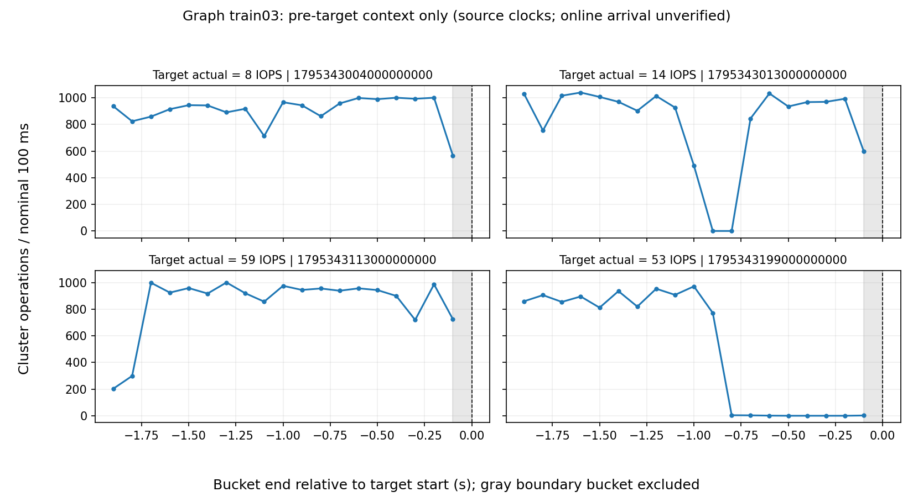

# B核验：Graph R0细粒度交付

request_id=B19-FINE-SCHEMA-SAMPLE-20261122-01；status=verified，**仅限实际交付范围**。来源[A Release](https://github.com/Learning-A/final_test/releases/tag/graph-fine-context-r0-20261122-v1)，ZIP SHA256=9f25bff3f4870ccb9f2b7e96e82d79d1d544dc4b627101061d881564a78d6752，export_manifest SHA256=0760df3be375363cee7f67ef3f0b329da14fa7a665138be6859ebb83cd4d985b。

## 已独立核验

- 实际交付为graph_zipf_train_03的完整100ms核心和四个训练角色事件邻域，另有七事件审计JSON；原role=train保持，未把验证事件改为训练。
- 59,562条fine记录、41,031条原始邻域记录及审计文件哈希/大小匹配；来源manifest/quality/topology匹配已有20轮数据，24个原始文件哈希与原quality清单一致。
- 全部5,921个原有效node/client7414秒窗的read/write/total完全一致，36个不完整窗的标记也一致，不补零。
- 从原始邻域累计计数重新差分/聚合，四事件共360个100ms节点/客户端桶与fine文件一致。
- 与旧P2固定sample_ids比较，Graph train03仍为544个内部开发秒，新增近端缺失mask不改变原样本集合。
- 七个事件与原train/validation包对照，96OSS完整、八节点完整、集群及client7414值一致；四训练事件集群8/14/59/53，客户端0/0/48/44；三验证事件集群4/5/2、客户端均0。不能将七个事件统称为客户端完全归零。

结果JSON：[graph_r0_b_receipt.json](../reports/graph_r0_b_receipt.json)。这是数据核验，不是训练/模型精度评估，外部开发验证新增模型评估0。

## 新的输入诊断线索

仅查看四个已登记训练角色低值事件的目标前上下文，不拟合/调阈值。以源端时间、D=T−30ms、处理预算0作为**尚未获线上证明的候选上界**；最后跨到T的100ms桶被排除。图中操作次数不冒称实际间隔归一化速率。

集群实际53的事件：目标前约0.9至0.1秒结束的桶已连续降至4/3/1/0/0/0/0/2次操作，近端输入有可观察变化，旧完整秒历史无法充分表达。实际8/14事件临近目标前的下降较短；实际59事件最近可用桶仍为725次，不能宣称全部低值均有同样前兆。四个事后选定事件不构成总体预测力或达标证据，需在完整轮、共同样本及正常窗口上对照。

A审计给出的邻近Vdbench区间最低0/0/44/38及验证三处0，与低活动现象相符；B尚未取得原始Vdbench日志，不能独立认证日志对齐或归因为GC。此证据更支持保留这些有效低正值，而非按模型误差当异常删除。

## 未交付或未核定的部分

- 现包仅一个train03，缺train01/02拟合范围和其余四负载细粒度数据；不能执行既定五负载跨轮拟合，更不能把544内部开发秒改成训练。
- 验证三个事件仅审计摘要，未交原始细粒度邻域；不妨碍接受当前train03核心，但不写成全部原请求附件均已收到。
- 仍仅source_read_end证据，线上到达与跨机时钟界未知，online_ready=false；不能声称现场因果可用或30ms通过。
- latency/op_wip/rpc等原单位待核定，不能直接派生特征。exporter_commit仅短版上游SHA，A对身份字段的哈希脱敏已有声明，仍需实际执行导出/脱敏脚本的精确SHA/配置。

## 可复算入口与下一步

`scripts/audit_graph_fine_r0.py`只读执行，固定Release/原train/validation/index/topology/sample_ids哈希；参数为--directory、--archive、--train、--validation、--index、--topology、--sample-ids、--output。不联网、不拟合、不修改原标签，七验证事件只作数据审计。

B在原request_id回复本范围verified，并将下一阶段完整训练角色范围作为独立request_id交A，避免重复导出已核验的train03。先由A确认字段/时间证据和可交付范围，再登记训练runner/实际卡与共享锁；不因样例通过直接越过整批数据和时间门槛。
