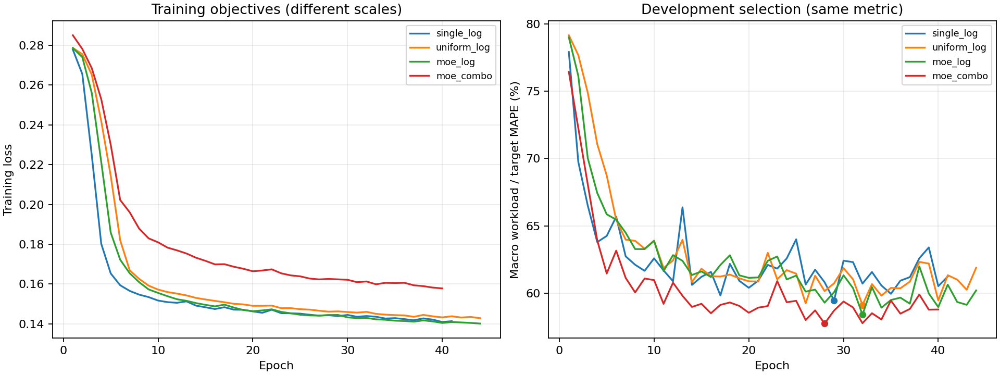

# masked多组MoE与组合损失：首个有界GPU结果

实验masked-multigroup-moe-v1，成功job masked_multigroup_moe_v1_a02，源码`06dc5e7116ca0abca05690b83640cf3b52fb479f`。b507单空闲A40、CPU4线程/workers0，墙钟57.71秒，未改环境或启动负载。四组固定对照均完成。首次a01在训练前因确定性CUDA median失败，原目录/log保留；a02将同一训练统计定义移至服务器CPU后成功，无Windows拟合或预算扩展。

## 数据和输入

五类首轮健康候选，仍为train源角色，实际负载时钟边界pending。signed-log训练归一化排除masked占位，mask保留原值。短35维、带mask长77维、空间32维，共144。训练1514秒、开发762秒，其中旧strict15共同开发697秒；同轮固定时间分区及历史下限，不代表独立轮。所有输出和标签为八节点各12OSS聚合以及独立集群总量。

## 四组同输入结果

指标为五类×九目标正值MAPE宏均值（%），各组用同一开发指标选checkpoint和patience12早停，最多60epoch。训练loss与最终选模指标不同，全部轨迹、最佳epoch和训练尺度在JSON。此宏均值只是选模指标，不替代逐节点逐正式轮的门槛。

|方案|最佳epoch|762秒宏MAPE|697秒共同宏MAPE|九输出CPU中位ms|
|---|---:|---:|---:|---:|
|single_log|29|59.45|62.09|0.806|
|uniform_log|32|59.11|61.71|0.823|
|moe_log|32|58.39|60.96|0.772|
|moe_combo|28|57.74|60.09|0.774|

同输入上，学习门控MoE相对单专家由59.45降至58.39%，再加入组合损失至57.74%，总计约1.71个百分点。它是单seed、复用开发集的探索收益，不是独立显著性证据。单专家和MoE参数量不等；均匀融合是相同专家容量的门控对照。

## 697秒共同窗口的直接集群MAPE%

|方案|AI训练|AI推理|Baleen|图计算|HPC|
|---|---:|---:|---:|---:|---:|
|single_log|43.44|374.04|48.10|41.98|38.25|
|uniform_log|42.62|352.88|48.00|42.94|36.35|
|moe_log|42.78|335.16|47.88|41.87|38.46|
|moe_combo|44.00|335.68|46.55|41.00|42.06|

组合损失相对moe_log改善Baleen和图计算，但HPC集群MAPE38.46→42.06%，AI训练42.78→44.00%；AI推理仍335.68%。不能以宏平均改善掩盖失败。八节点逐负载MAPE/MAE/WAPE/零值及节点预测求和集群均在JSON，所有低正值继续计入MAPE。原树在相同697秒宏MAPE70.33%，当前组合MoE60.09%；但新模型训练样本已从1215扩至1514，此比较不能把全部收益归因架构。

## 门控与运行证据

moe_combo上层短/长/空间平均门控约0.388/0.384/0.227，平均熵0.969（最大ln3≈1.099）；长组内平均0.330/0.670。聚合统计未显示全局单专家独占，但未完成逐专家移除/置换，不能证明有效分工。single_log的未使用专家诊断不作解释。

全部四模型GPU/CPU双精度TorchScript对拍最大相对差异小于2e-15；54之前树模型与本次四模型不是同一种对拍。400组包含节点/直接集群/求和集群、全覆盖/共同交集的指标独立复算一致；样本及预测SHA已核验，raw=final，无校准。CPU一次八节点加集群约0.77–0.82ms，p95均<0.85ms，不含特征构造/网络/现场发布，不是现场30ms通过证据。

权重.ts、checkpoint.pt、完整曲线/progress、raw/final预测、环境/命令/代码ZIP哈希保存在`/home/lmj/idfs_forecast_lab/model_b_20261122T074416Z/masked_multigroup_moe_v1_a02`。小报告/曲线提交仓库，大预测已交接至B工作区。共享锁由父进程全程持有，正常退出释放；A尚未确认新协议，旧worker不会自动采用，双方后续GPU任务应统一使用已公告锁/登记。

## 当前决定与下一步

不冻结、不报告达标。累计已查看13种不同开发配置（本轮新增4种，包含epoch级checkpoint选择）；不得重复周期性跑本实验。下一步优先新独立开发轮和A的负载边界/接收证据；再做同输入专家移除/置换与贡献归因，定位空间/长历史价值和HPC退化。若继续损失改动，应固定一项因素做有界对照，不能依据此开发集无上限搜索组合权重。客户端/OSS内部/100ms特征仍需按既有采集可用性和因果到达证据补齐，不由B启动采集。
