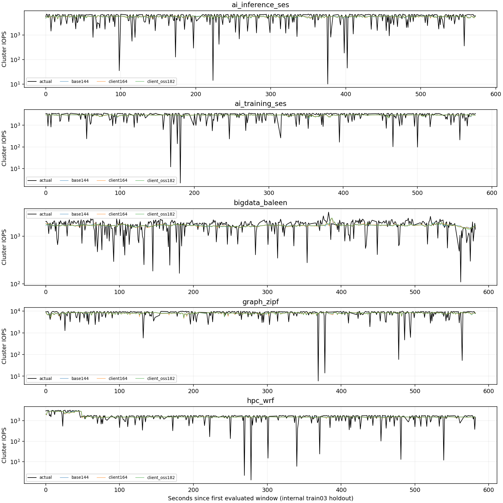

# 原生机制驱动的客户端/OSS输入对照结果

experiment_id=workload-causal-input-v1，job workload_causal_input_v1_a01，源码e7f1db65aa8c963a8261532df7f260e9c9c814a0。已在b507 CPU4/workers0完成，墙钟95.97秒，未占GPU或修改环境、未启动负载。定时任务保持PAUSED，当前聊天手动执行。

## 协议

15个原train角色完整轮按index1/2共10轮拟合，index3共5轮内部开发；5328拟合秒、2661内部开发秒。内部开发源角色仍train，不伪称validation；本轮没有读取validation.zip进行选模，首次独立验证消费计数维持1。所有数据/拓扑/代码/样本/权重哈希和每捕获覆盖见JSON。

三组固定相同ExtraTrees64/depth8/leaf3/seed2026、原尺度平方误差，只有输入不同。base144、client164、client_oss182每节点分别144/164/182维，直接集群928/948/1092维。客户端五lag和mask，节点内12OSS分布/集中度/覆盖等38维真实历史已接入；全部方案使用同一批样本，额外缺失只mask，不删标签。没有阶段真值、未来秒或系统遥测插值。

## 结果

|输入|五负载×九目标宏MAPE%|节点×负载达标组|
|---|---:|---:|
|base144|134.16|0/40|
|client164|134.03|0/40|
|client_oss182|134.79|0/40|

集群MAPE%：

|负载|base144|client164|client_oss182|
|---|---:|---:|---:|
|ai_inference_ses|274.04|276.70|268.35|
|ai_training_ses|238.96|239.52|245.47|
|bigdata_baleen|36.11|35.93|35.90|
|graph_zipf|373.31|361.04|373.90|
|hpc_wrf|351.11|351.20|358.52|

秒级客户端增量宏指标仅134.16→134.03%，再加OSS分布为134.79%；没有可靠整体收益，不能宣传为提升或据单组最好值冻结。此处是新第三训练轮完整内部开发，与旧697/762秒分数和新validation轮141%不是相同数据，不直接横比。单seed差0.13个百分点不构成稳定性证据。

27个模型序列化前后CPU预测对拍通过；150组节点/直接及求和集群指标独立复算，样本/预测SHA一致。原尺度MSE训练loss、每模型训练耗时和权重哈希保留。树没有epoch/早停曲线，输出五类逐窗口实际/预测曲线，真实零/低正值保留。

## 与负载原生机制的关系

上游fb83711及20轮model SHA已匹配。AI训练/推理没有原生epoch/prefill/decode，不能发明周期特征；图固定Zipf纯读/iorate=max也未提供短停计划。WRF阶段和Baleen每秒分布是有效先验候选，但真实native RD开始/预先可用计划尚未与发布时钟核验，本轮不使用recording_start冒充业务阶段起点。

当前模型能跟随多数稳定平台和部分WRF读写切换，仍遗漏突然下跌到个位数IOPS的秒。客户端同目标秒也归零、96OSS完整，因此不能把这些点按缺失/异常丢掉；当前最近可用秒早于该目标1秒，新增同尺度历史可能没有足够先行信息。因果可用的100ms近端信息、Vdbench/GC/系统压力与精确阶段证据优先于进一步增加秒级维度或专家数。

下一步：核对已有原始计数/应用日志的短停，准备时间安全的100ms及5秒系统状态as-of join；只有时间证据足够才启用阶段先验。之后在固定合理骨干和输入上做单因素损失/状态头对照。Huber或两部分状态预测是候选，不能把目标低值状态直接当门控输入，亦不能保证未知外部停顿可预测。正式八节点100-MAPE口径不变。
