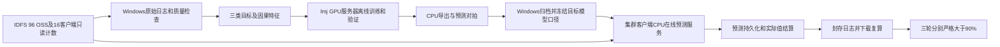

# 数据采集训练预测工作流

最新执行范围已改为8个存储节点IOPS及一轮实测冒烟，见[存储节点IOPS冒烟测试](存储节点IOPS冒烟测试.md)。下文client7414目标与35轮方案是历史准备内容。

2026-11-21最新确认：正式目标固定client7414总IOPS，三路MoE采用存储上下文联合输入；五类各3训练+1验证+3正式，共35轮。联合输入、数据分轮、MoE任务和当前前置条件以[采集前准备与确认清单](采集前准备与确认清单.md)为准。下文单目标模型流程保留用于辅助比较；全OSS模型不能作为当前正式对象冻结。

本工作流将采集、训练和在线预测分开放置。训练在 `lmj@192.168.1.13` 的GPU服务器进行；集群只运行只读数据源和训练后的CPU预测服务；Windows工程负责控制、传输、归档和独立复算。本次只探查环境并准备本地脚本，没有上传或执行远端训练、部署和在线任务。



## 主机与权限

| 位置 | 账户及路径 | 负责内容 |
|---|---|---|
| Windows | 当前 `idfs_forecast_lab` 工程 | 探查、只读采集控制、原始记录、处理、传输和复算 |
| GPU服务器 | `lmj@192.168.1.13`，主机 `b507`，UID1010 | 离线训练、验证、CPU导出和导出对拍 |
| GPU新工程 | `/home/lmj/idfs_forecast_lab/jobs/<job_id>` | 每任务独立代码、数据、结果、缓存及日志 |
| 集群客户端 | `hust@100.7.74.14` | 训练后CPU预测、EWMA残差校准、预测及结算落盘 |
| 集群新服务目录 | `/home/hust/idfs_forecast_inference` | 按模型包哈希保存不可覆盖的发布目录，每轮独立输出 |
| 存储节点 | 桥接已有信任的 `idfs` 账户 | 本地Unix socket只读计数，不训练、不改守护进程 |

GPU服务器的身份、系统和环境来自本次只读探查：Ubuntu24.04.4，160逻辑CPU、约251GiB内存，两张NVIDIA A40，每张46068MiB显存，驱动580.159.03。探查时两张卡均无计算进程；这是快照，不是GPU预约。

GPU服务器已有lmj自己的长期运行进程，包括ceph-fuse和bash。本次不停止或修改它们，未来脚本也不提供全局kill、pkill、清理或重启操作。

## 已有训练环境

| 用途 | Python绝对路径 | 本次读取到的包 |
|---|---|---|
| 表格模型 | `/home/lmj/miniconda3/envs/tabkd/bin/python` | Python3.10.20，LightGBM4.6.0，XGBoost3.2.0，scikit-learn1.7.2，NumPy2.2.6 |
| GRU和TCN | `/home/lmj/miniconda3/envs/tsfm/bin/python` | Python3.11.16，PyTorch2.4.1，CUDA构建12.1，NumPy1.26.4 |

环境版本通过读取包元数据确认，没有激活环境、安装包、升级包或执行训练。训练前仍会检查实际可用性。使用Python绝对路径与隔离模式，不修改`.bashrc`、conda环境或全局配置。

GPU服务器上还存在 `/home/lmj/model_with_monitor/FourierGNN-main`、`SPFaaSTest-main` 和 `/home/lmj/model/Time-Series-Library-main` 等源码目录。它们只登记为已有资产，不改其文件，也不把旧权重当作当前IDFS新数据的模型。当前通用任务入口支持last_value、rolling_mean、Ridge、HistGB、LightGBM、XGBoost、GRU、TCN；GAT-GRU、FourierGNN及TSLib模型仍需专用多实体输入适配。

## 资源和文件边界

- 所有GPU新任务限定在lmj的新工程根目录，检查账户、主机、UID、目录属主和路径。拒绝`..`、越界路径和符号链接目录；已有任务目录不覆盖。
- 新任务自己的OpenMP、MKL、OpenBLAS等线程最多4个，DataLoader workers为0，优先级只对新worker降低；不会更改其他进程的线程数、优先级或亲和性。
- GRU/TCN启动前选择没有计算进程、利用率0、显存占用很低的一张GPU，并只给新任务设置`CUDA_VISIBLE_DEVICES`。没有空闲卡就退出，不驱逐任何任务、不修改GPU全局模式。表格模型默认在这台服务器上使用4个CPU线程。
- 临时文件、CUDA和Torch等缓存也指向新任务的scratch目录，不改lmj既有缓存。
- 共享`/home`本次约98%已用、剩余约76G。只传计数特征，不传数TiB负载容器。单次上传预算20GiB，上传后至少保留15GiB空闲；不足则退出，不清理他人或旧工程。
- 认证仍运行时读取原`GPU服务器.txt`，不复制口令到工程、任务清单或日志。SOCKS5连接由现有Python实现，不依赖说明中可能不存在的ncat。

## 第一阶段 采集与处理

后续进入采集阶段再执行。普通命令先显示计划，添加`--execute`才启动只读采样：

```powershell
python -m idfs_lab.cli collect --seconds 660 --out runs/train_capture_01
```

采集全部三类来源：客户端NFS/RPC、逐OSS以及全96OSS聚合。记录原始累计读写计数、源采样起止、monotonic、网格、socket/挂载身份、接收时间、失败与重置信息。缺桶不补零、不插值。全OSS目标只由完整96个OSS构成，不混加客户端计数。

采集稳定后再由负载终端运行已准备的最新负载，工具使用同事的共享数据，不重新prepare。当前脚本不会自动启动或停止负载。训练采集、验证采集和正式测试使用不同run_id；各阶段保留版本和数据库存。

```powershell
python -m idfs_lab.cli process --input runs/train_capture_01 --out runs/train_processed_01
python -m idfs_lab.cli export-features --windows runs/train_processed_01/windows.jsonl --run-id train_capture_01 --out runs/features_train.csv
```

验证轮同样处理成 `runs/features_validation.csv`。通用基线使用五个已可用历史秒及滚动均值，标签为后续完整1秒IOPS。最新MoE另用415维联合JSONL，时序、96 OSS拓扑及跨层特征的构造代码由离线和在线共用，见最新清单。

## 第二阶段 GPU服务器离线训练

修改任务JSON中的数据路径、目标和模型。示例分别为：

```text
config/gpu_job.example.json        全OSS合计IOPS的LightGBM任务
config/gpu_job_gru.example.json    client7414合计IOPS的GRU任务
```

先生成计划，不连接、不上传、不启动训练：

```powershell
python -m idfs_lab.cli gpu-submit --spec config/gpu_job.example.json --out runs/submission_cluster_lgb
```

输入不存在时 `execute_ready=false`，列出缺失路径。数据准备好并进入训练阶段，再添加`--execute`。提交后新建远端任务目录，传输源码、特征及协议并逐项校验，前台执行；训练stdout返回Windows，同时模型元数据保存完整训练轮、验证轮、输入哈希及验证分数。

训练入口强制 `lmj@b507` 和本工程job根目录，Windows或IDFS节点直接调用fit入口会拒绝执行。训练/验证轮不相交，不随机拆分相邻窗口，不使用正式三轮参与选择。GRU/TCN有固定随机种子、按验证集早停、只保存最佳checkpoint；不占用额外DataLoader进程。

## 第三阶段 CPU导出与回传

训练worker完成后自动导出：

| 训练模型 | 集群推理格式 | 集群运行依赖 |
|---|---|---|
| last_value、rolling_mean | JSON规则 | Python标准库 |
| Ridge | JSON有效系数与截距 | Python标准库 |
| LightGBM、HistGB、XGBoost | JSON数值树集合 | Python标准库 |
| GRU、TCN | CPU TorchScript与元数据 | 匹配且通过检查的CPU PyTorch运行环境 |

数值树仅支持当前数值特征。导出后必须在冻结验证输入上对拍，超过容差或遇到不支持结构则退出，不产生可部署结论。GRU/TCN另检查GPU输出与CPU输出差异。部署包带预测测试向量，目标集群再次做CPU运行对拍；环境不兼容就停在未启动状态，不现场安装包或偷偷降级模型。

结果目录包括：

```text
results/model/model_manifest.json    原模型、训练和验证记录
results/cpu_export/                  CPU模型、导出对拍结果、测试向量
results/inference.tar.gz             仅推理运行时与已训练模型
results/inference.tar.gz.json        包内容和校验值
job_result.json                     完成或失败原因、使用的GPU UUID
```

默认先显示下载计划，进入回传阶段才添加`--execute`：

```powershell
python -m idfs_lab.cli gpu-fetch --job-id cluster_total_lgb_v1 --out runs/returned_cluster_lgb
```

下载只读取本工程lmj任务的results和job_result，校验属主，不扫描或取回其他用户的数据。

## 第四阶段 选择与冻结

客户端7414总IOPS为固定正式目标，在其验证轮比较基线与MoE后选模型；其他客户端、逐OSS及全OSS只作辅助分析。不能观察正式结果后换对象、模型或阈值。

```powershell
python -m idfs_lab.cli freeze-selection --model-manifest runs/returned_joint_moe/results/model/model_manifest.json --workload hpc_wrf --workload-commit fb83711a1226f59899ed034b9195402156ef57d6 --out models/selection_wrf_v1.json
```

冻结文件记录目标、原模型哈希、训练/验证轮和协议哈希，每类三轮共用。准确率使用MAPE，仅排除实际零值，结果按未显示舍入值严格大于90%判定，日志展示4位小数。

## 第五阶段 集群只接入预测

先看部署计划；以后进入部署阶段再添加`--execute`：

```powershell
python -m idfs_lab.cli stage-inference --bundle runs/returned_cluster_lgb/results/inference.tar.gz
```

部署到 `/home/hust/idfs_forecast_inference/releases/<包哈希前缀>`，不覆盖 `/opt/baize` 或同事目录。包不包含training.py、offline_job.py、models_torch.py、优化器或GPU训练流程。仅解包、核验和运行CPU测试向量，不自动启动服务、不改systemd、不安装依赖。

在线服务由独立前台SSH会话启动，读取计数流并在client7414的时钟下记录真实接收时刻。Windows采集控制器仍保留原始数据，同时通过SSH stdin把只读计数发给已训练服务。没有新建公开监听端口。

进入在线测试前先显示计划：

```powershell
python -m idfs_lab.cli relay-live --release /home/hust/idfs_forecast_inference/releases/实际哈希 --selection models/selection_wrf_v1.json --clock evidence/clock_verified.json --first-io runs/wrf_1_first_io.json --out runs/formal_wrf_1 --run-id formal_wrf_1 --round-index 1 --seconds 660 --formal
```

以后添加`--execute`才真正启动该新预测会话与只读采样。它不启动负载，也不操作任何旧PID。启动后等待各源稳定再由负载终端启动任务；`--formal`要求时钟证据已通过。探索模式不能被三轮汇总当成正式验收。

预测每秒在目标窗口前计算，日志记录计算完成时间、特征向量及可用时间、模型原始输出、EWMA状态、最终预测和fsync后的持久化确认。只在未来实际窗口闭合后更新残差；这只是已训练模型的在线残差校准，不进行梯度训练或模型重拟合。暖机期记录`cold_uncalibrated`，如实表示暂不施加残差，不冒称持久性模型。

原始计数和实际窗口以100ms批量flush/fsync，预测审计事件逐条fsync，避免对全部高频计数逐条同步写盘造成反压。缺失或迟到会留下质量事件并使正式复算失败。

## 首I/O和时间接口

负载工具需要提供真实首请求事件，并在Windows控制端保存到本轮新的JSON文件：

```json
{"event":"recording_start","epoch_ns":0,"source_log_sha256":"本轮记录起点证据校验值"}
```

上例是字段说明，0是不能用于测试的占位值，必须替换为本轮开始记录时刻的epoch纳秒整数。relay拒绝0，检测新文件后把事件、文件哈希及其内容传给服务。文件必须为本轮新建，不能复用旧t0。若负载工具提供实际首I/O，可将事件改为`tool_first_io`并同时保存原生日志。

集群主测试组本次相对偏差估计约2.3ms，但公网测量不确定度约36ms，仍未满足当前25ms限值。正式模式保留阻断，后续需补局域网或其他足够精度的时间证据。GPU服务器显示UTC不影响离线训练；保留源epoch，不能用训练机时间重写t0或预测时刻。

## 第六阶段 封存和复算

采集自然结束后关闭本次SSH输入。服务完成所有已收到计数后写结束标记；relay再封存本轮日志哈希并下载必要产物。此流程没有通用停止其他任务的命令。

```powershell
python -m idfs_lab.cli verify --run runs/formal_wrf_1 --out runs/formal_wrf_1/verification.json
python -m idfs_lab.cli summarize runs/formal_wrf_1/verification.json runs/formal_wrf_2/verification.json runs/formal_wrf_3/verification.json --out runs/wrf_three_rounds.json
```

复算检查首I/O证据、选择冻结时间、协议和模型版本、日志字节哈希、特征可用时间、预测完成及持久化时间、完整十桶实际值、启动时刻和评价区间。三轮分别严格大于90%，任何一轮失败就失败，不取平均放行。

## 本轮完成与后续验证

本轮已完成GPU只读探查、工作流脚本和本地边界测试。没有在GPU服务器创建工程目录、上传数据或训练，也没有在集群部署/启动新服务。既有lmj进程、其他用户及其进程没有变动。

下一阶段仍需真实采集数据、GPU训练与CPU导出验证、目标集群运行检查，以及首I/O工具接口和时间证据。不能把本地合成测试或探测快照当作当前集群准确率、GPU训练成功或正式三轮通过。
